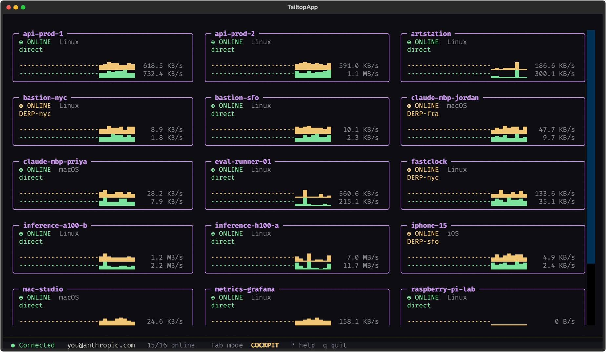
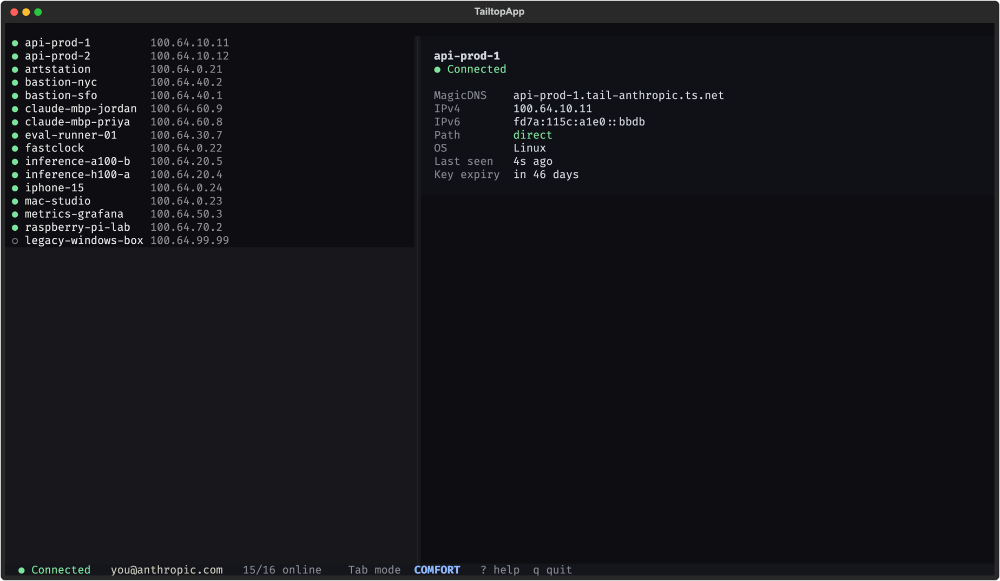
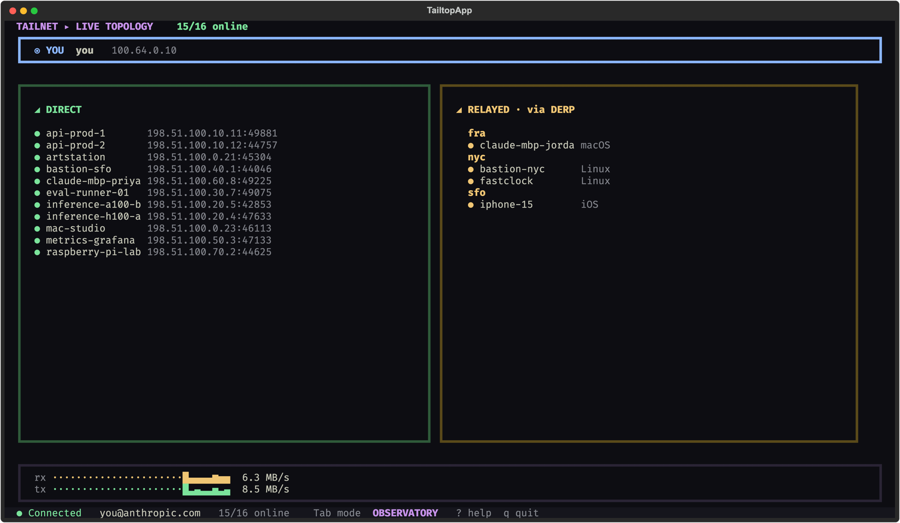

# tailtop

**Problem.** Managing a tailnet means the official GUI or one-off `tailscale` commands such as ping, whois and netcheck, and neither gives a live overview of every device inside a terminal.

**Idea.** htop for your tailnet: a second front-end to the `tailscaled` daemon that is already running. Three modes, one per intent (manage, operate, observe), each with its own view and theme.

**Built.** A Python 3.13 terminal UI on Textual that installs nothing on the Tailscale side and needs no root, with a `--demo` mode that runs a synthetic tailnet. 11 commits on 4 days, Jun 6 to Oct 20, 2026.

**Decision.** The `--demo` flag swaps in a synthetic client with the same surface as the real one, so screenshots and design review do not need a running `tailscaled`.



A terminal UI for Tailscale — *htop for your tailnet.*

`tailtop` is a second front-end to the `tailscaled` daemon already running on
your machine (the same daemon the official GUI uses). It installs nothing on
the Tailscale side, needs no root, and runs entirely in your terminal.

## Modes

`Tab` cycles between three modes, each tuned to one intent:

| Mode | Intent | View | Theme |
|------|--------|------|-------|
| **Comfort** | manage | List (GUI parity) | Studio |
| **Cockpit** | operate | Live cards + sparklines | Mission Control |
| **Observatory** | observe | Network topology | Brutalist |

| Comfort | Observatory |
|---|---|
|  |  |

Screenshots are from `tailtop --demo`, which runs a synthetic tailnet.

## Keys

| Key | Action |
|-----|--------|
| `Tab` | cycle modes (Comfort → Cockpit → Observatory) |
| `j` / `k` / `↑` / `↓` | navigate devices |
| `⌘P` / `Ctrl+P` | command palette (all verbs for the selected device) |
| `p` | ping · `c` copy IP · `w` whois · `n` netcheck |
| `e` | toggle exit node · `f` send file · `s` SSH |
| `r` | refresh · `?` help · `q` quit |

Mutating actions (exit node, funnel, send) confirm first. SSH suspends the
TUI, hands the terminal to `tailscale ssh`, and resumes on exit.

## Requirements

- The `tailscale` CLI on your `PATH` (the daemon must be running). Not needed with `--demo`.
- Python ≥ 3.13.

## Run

```sh
uv run tailtop
uv run tailtop --demo   # synthetic tailnet, no tailscaled needed (or TAILTOP_DEMO=1)
```

A short boot splash shows while the first status call is in flight; any key dismisses it.

## Develop

```sh
uv venv --python 3.13
uv pip install -e ".[dev]"
uv run pytest
```

## Design

The design spec (`2026-06-05-tailtop-tui-design.md`) lives in the parent monorepo, not in this repository.

Visual inspiration from [Bagels](https://github.com/EnhancedJax/Bagels); no
code is copied (Bagels is GPL-3, tailtop is BSD-3).
