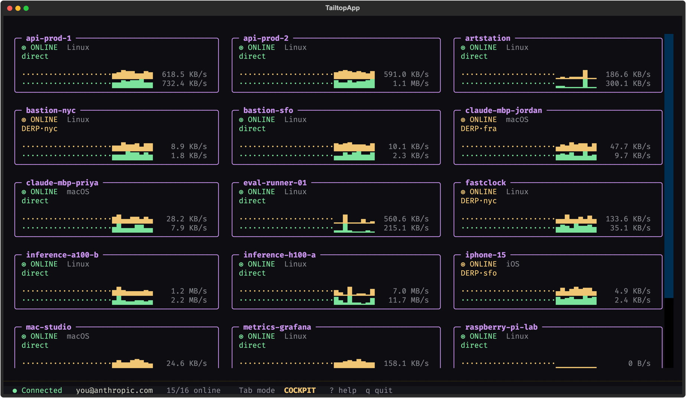
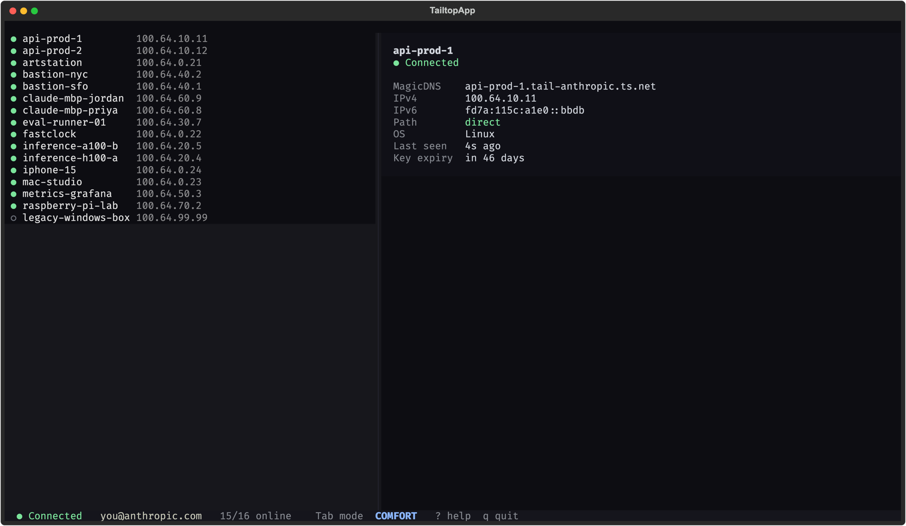
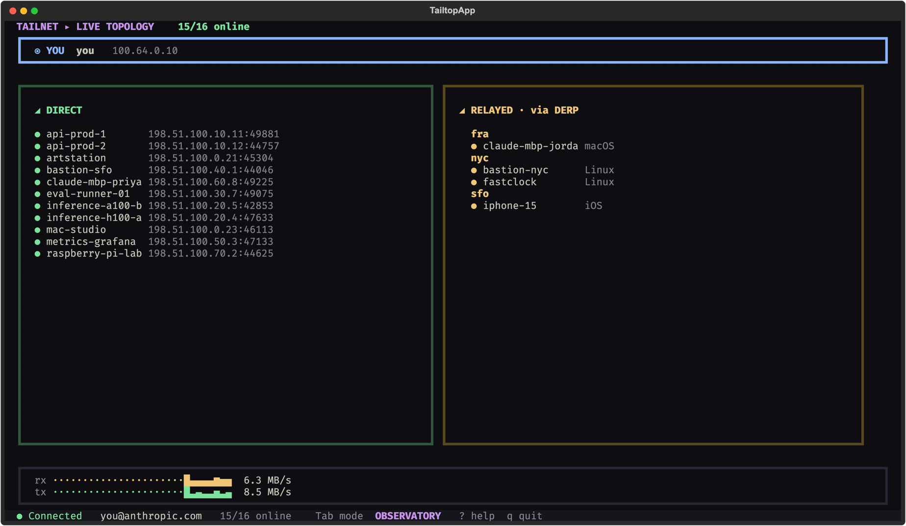

# tailtop

**Problem.** Managing a tailnet means the official GUI or one-off `tailscale` commands such as ping, whois and netcheck, and neither gives a live overview of every device inside a terminal.

**Idea.** htop for your tailnet: a second front-end to the `tailscaled` daemon that is already running. Three modes, one per intent (manage, operate, observe), each with its own view and theme.

**Built.** A Python 3.13 terminal UI on Textual that installs nothing on the Tailscale side and needs no root, with a `--demo` mode that runs a synthetic tailnet. 11 commits on 4 days, Jun 6 to Oct 20, 2026.

**Decision.** The `--demo` flag swaps in a synthetic client with the same surface as the real one, so screenshots and design review do not need a running `tailscaled`.



A terminal UI for Tailscale — *htop for your tailnet.*

`tailtop` is a second front-end to the `tailscaled` daemon already running on
your machine (the same daemon the official GUI uses). It installs nothing on
the Tailscale side, needs no root, and runs entirely in your terminal.

## Modes

`Tab` cycles between four modes, each tuned to one intent; `1` to `4` jump straight to one:

| Mode | Intent | View | Theme |
|------|--------|------|-------|
| **Comfort** | manage | List (GUI parity) | Studio |
| **Cockpit** | operate | Live cards + sparklines | Mission Control |
| **Observatory** | observe | Network topology | Brutalist |
| **Fleet** | check the boards | Linux boards, worst first | Fleet |

| Comfort | Observatory |
|---|---|
|  |  |

Screenshots are from `tailtop --demo`, which runs a synthetic tailnet.

## Keys

| Key | Action |
|-----|--------|
| `Tab` | cycle modes (Comfort → Cockpit → Observatory → Fleet) |
| `1` to `4` | jump to a mode |
| `j` / `k` / `↑` / `↓` | navigate devices |
| `⌘P` / `Ctrl+P` | command palette (all verbs for the selected device) |
| `p` | ping · `c` copy IP · `w` whois · `n` netcheck |
| `e` | toggle exit node · `f` send file · `s` SSH |
| `r` | refresh · `?` help · `q` quit |

Mutating actions (exit node, funnel, send) confirm first. SSH suspends the
TUI, hands the terminal to `tailscale ssh`, and resumes on exit.

## Fleet mode

Fleet answers "is any board broken, and since when" for the Linux devices on
the tailnet (Raspberry Pis driving clocks and dashboards, say). Boards are
ranked worst first: **down** (offline in Tailscale, with days since last
seen), **unreachable** (online but the probe failed), **useless** (online, but
its app service is not running), **warn** (70 °C or hotter, disk 85 % or more,
memory 90 % or more, load at twice the core count, or under-voltage or
throttling right now), then **ok**.

While the tab is open, tailtop probes each online board every 30 s over
`tailscale ssh` with one read-only shell script: uptime, load, temperature,
memory, root disk, `vcgencmd get_throttled` and `systemctl is-active` for the
board's service. Nothing is installed on the boards and nothing needs sudo.
History (temperature and load sparklines) lasts as long as tailtop is open.

| Key | Action |
|-----|--------|
| `R` | restart the board's service |
| `B` | reboot the board |
| `s` | SSH to the board as its configured user |
| `r` | probe now |

`R` and `B` show the board and the exact command first. On yes, tailtop hands
the terminal to `tailscale ssh -t … sudo systemctl …` so you type the sudo
password on the board; tailtop never sees or stores it. After a reboot the
board shows **rebooting** for up to 3 minutes.

Configuration is optional. Copy [`fleet.example.toml`](fleet.example.toml) to
`~/.config/tailtop/fleet.toml` to set the SSH user, the service that means a
board is doing its job, labels, boards to ignore, or `only_listed = true`.
Without a user, probes run as Tailscale's default SSH user; a board that
refuses it shows "set user in fleet.toml".

## Requirements

- The `tailscale` CLI on your `PATH` (the daemon must be running). Not needed with `--demo`.
- Python ≥ 3.13.
- Fleet mode: Tailscale SSH enabled on the boards for your user.

## Run

```sh
uv run tailtop
uv run tailtop --demo   # synthetic tailnet, no tailscaled needed (or TAILTOP_DEMO=1)
```

A short boot splash shows while the first status call is in flight; any key dismisses it.

## Develop

```sh
uv venv --python 3.13
uv pip install -e ".[dev]"
uv run pytest
```

## Design

The design spec (`2026-06-05-tailtop-tui-design.md`) lives in the parent monorepo, not in this repository.

Visual inspiration from [Bagels](https://github.com/EnhancedJax/Bagels); no
code is copied (Bagels is GPL-3, tailtop is BSD-3).
